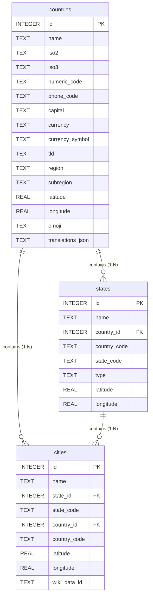

# MoinoGeo Technical Architecture & Integration Guide

Welcome to the technical documentation for **MoinoGeo**, an offline-first, high-performance geography library for iOS, macOS, and Android. MoinoGeo delivers comprehensive world geographic data—including regions, countries, states/provinces, over 150,000 cities, vector SVG flags, and TopoJSON country boundaries—without requiring network requests or external API keys.

---

## 1. Architecture & Design Philosophy

MoinoGeo is engineered around the principle of **zero-latency, offline-first execution**. Traditional geographic and geocoding services rely on REST APIs, introduce network latency, enforce rate limits, require API keys, and present privacy risks. MoinoGeo embeds optimized datasets directly into client application binaries.

```
+-------------------------------------------------------------------------+
|                            MoinoGeo Client                              |
+-------------------------------------------------------------------------+
|   iOS / macOS (Swift)                     Android (Kotlin)              |
|   - Swift Package Manager                 - Gradle Module / AAR         |
|   - SQLite3 / GRDB / SwiftData            - Room / SQLite / Driver      |
+-------------------------------------------------------------------------+
                                    |
          +-------------------------+-------------------------+
          |                         |                         |
          v                         v                         v
+-------------------+     +-------------------+     +-------------------+
| SQLite Database   |     | TopoJSON Maps     |     | Vector SVG Flags  |
| - 150k+ Cities    |     | - Natural Earth   |     | - ISO 3166-1 α-2  |
| - B-Tree Indexed  |     | - Quantized Arcs  |     | - Minified SVGs   |
+-------------------+     +-------------------+     +-------------------+
```

### 1.1 Why SQLite + TopoJSON + SVG?

1. **Relational Data via SQLite:**
   - Querying 150,000+ cities and multi-level administrative hierarchies (Country → State → City) requires complex relational joins, spatial coordinate bounding queries, and full-text searches.
   - SQLite provides zero-configuration, cross-platform, embedded SQL evaluation with native C-bindings on both Apple (libsqlite3) and Android (sqlite3/Framework) operating systems.

2. **Map Boundaries via TopoJSON:**
   - GeoJSON repeats coordinate pairs for shared boundaries between adjacent geographic entities (e.g., the border between France and Spain).
   - **TopoJSON** encodes topology rather than discrete polygons. Shared boundaries are stored as single shared "arcs", eliminating coordinate redundancy and reducing raw boundary payload size by **70% to 80%** compared to GeoJSON.

3. **Flags via Vector SVG:**
   - Raster images (PNG/WEBP) require multiple density variants (`@2x`, `@3x`, `hdpi`, `xxhdpi`) or suffer from scaling artifacts on high-DPI retina mobile screens.
   - Vector SVG flags scale losslessly to any resolution while keeping the total asset footprint per flag to ~1–3 KB.

---

### 1.2 Storage Optimization Breakdown

Mobile binary size budgets dictate strict limits on bundled assets. MoinoGeo employs three targeted optimization strategies to keep the overall storage footprint between **15 MB and 18.5 MB**:

| Component | Raw Unoptimized Size | MoinoGeo Optimized Size | Optimization Technique Applied |
| :--- | :--- | :--- | :--- |
| **Relational Data** | ~85 MB (Raw JSON) | **12.5 MB** (`moinogeo.db`) | SQLite page packing, Integer PK foreign keys, VACUUM compaction, B-tree indexes on `iso2`, `country_id`, `state_id`, `name`. |
| **Map Boundaries** | ~12 MB (GeoJSON) | **2.1 MB** (`world-50m.topojson`) | Arc topology encoding, 10,000-point coordinate quantization, floating-point delta encoding. |
| **Flags** | ~6.5 MB (Raw SVGs) | **1.8 MB** (`flags/*.svg`) | SVGO minification: removal of XML metadata, comments, hidden elements, and coordinate precision reduction. |
| **Total Asset Footprint** | **~103.5 MB** | **~16.4 MB** | **~84% Total Compression Ratio** |

#### Database Indexing Strategy
To ensure sub-millisecond query execution on mobile CPUs, B-tree indexes are built during offline database compilation:
- `idx_countries_iso2`: Direct lookup by ISO 3166-1 alpha-2 code (`iso2`).
- `idx_states_country`: Foreign key lookup retrieving all states for a specific country.
- `idx_cities_state`: Foreign key lookup retrieving cities by state.
- `idx_cities_country`: Foreign key lookup retrieving cities directly by country.
- `idx_cities_name_prefix`: Prefix index supporting autocomplete search inputs.

---

## 2. Data Sources & Licensing

MoinoGeo combines three high-quality open-source datasets. Each dataset retains its respective upstream license.

### 2.1 Attribution Table

| Asset Type | Source Project | Upstream Repository / Source | License | Usage in MoinoGeo |
| :--- | :--- | :--- | :--- | :--- |
| **Relational Geographic Data** | Countries States Cities Database | [`dr5hn/countries-states-cities-database`](https://github.com/dr5hn/countries-states-cities-database) | **ODbL v1.0** (Open Database License) | Pre-processed into SQLite database schema (`moinogeo.db`). |
| **Vector Country Flags** | Flag Icons | [`lipis/flag-icons`](https://github.com/lipis/flag-icons) | **MIT License** | Minified SVG files keyed by lowercase ISO 3166-1 alpha-2 codes. |
| **Vector Map Boundaries** | Natural Earth | [`naturalearthdata.com`](https://www.naturalearthdata.com/) | **CC0 1.0 Universal** (Public Domain) | Quantized TopoJSON vector polygons (`world-50m.topojson`). |

---

### 2.2 Commercial Compliance & Licensing Guidelines

Integrating MoinoGeo into commercial applications requires adherence to the licenses of its underlying datasets:

1. **Open Database License (ODbL v1.0) Compliance:**
   - **Attribution:** Commercial apps using MoinoGeo must include an attribution notice in their application (e.g., in an "About" or "Legal Notices" screen):
     > *"Geographic data provided by MoinoGeo, derived from the Countries States Cities Database by dr5hn, licensed under ODbL v1.0."*
   - **Share-Alike:** Modifying or extending the underlying database schema and redistributing the database file itself requires making those database modifications available under the ODbL. Bundling the unmodified `moinogeo.db` file within a proprietary application does **not** force your proprietary application code to become open-source.

2. **MIT License Compliance (Flags):**
   - Retain the MIT copyright notice in your legal documentation or license bundle.

3. **CC0 Public Domain (Natural Earth Map Data):**
   - Free to use, modify, and distribute commercially without restriction or mandatory attribution.

---

## 3. Data Schema Overview

The embedded SQLite database (`moinogeo.db`) follows a normalized 3-tier relational hierarchy (`countries` → `states` → `cities`) with localized name translations and spatial coordinates.



---

### 3.1 Table Specifications

#### `countries` Table
Contains top-level country metadata, international identifiers, currency data, and multi-language translations.

```sql
CREATE TABLE countries (
    id              INTEGER PRIMARY KEY AUTOINCREMENT,
    name            TEXT NOT NULL,
    iso2            TEXT NOT NULL UNIQUE, -- e.g. "US", "DE", "JP"
    iso3            TEXT NOT NULL,        -- e.g. "USA", "DEU", "JPN"
    numeric_code    TEXT,                 -- e.g. "840", "276", "392"
    phone_code      TEXT,                 -- e.g. "+1", "+49", "+81"
    capital         TEXT,
    currency        TEXT,                 -- e.g. "USD", "EUR", "JPY"
    currency_symbol TEXT,                 -- e.g. "$", "€", "¥"
    tld             TEXT,                 -- e.g. ".us", ".de", ".jp"
    region          TEXT,                 -- e.g. "Americas", "Europe", "Asia"
    subregion       TEXT,                 -- e.g. "Northern America", "Western Europe"
    latitude        REAL,
    longitude       REAL,
    emoji           TEXT,                 -- e.g. "🇺🇸", "🇩🇪", "🇯🇵"
    translations    TEXT                  -- JSON string: {"es": "Estados Unidos", "fr": "États-Unis", ...}
);

CREATE UNIQUE INDEX idx_countries_iso2 ON countries(iso2);
CREATE INDEX idx_countries_region ON countries(region);
```

#### `states` Table
Contains primary administrative subdivisions (states, provinces, territories, regions, cantons).

```sql
CREATE TABLE states (
    id              INTEGER PRIMARY KEY AUTOINCREMENT,
    name            TEXT NOT NULL,
    country_id      INTEGER NOT NULL,
    country_code    TEXT NOT NULL,        -- ISO2 country code
    state_code      TEXT,                 -- e.g. "CA", "BY"
    type            TEXT,                 -- e.g. "state", "province", "prefecture"
    latitude        REAL,
    longitude       REAL,
    FOREIGN KEY(country_id) REFERENCES countries(id)
);

CREATE INDEX idx_states_country_id ON states(country_id);
CREATE INDEX idx_states_country_code ON states(country_code);
```

#### `cities` Table
Contains over 150,000 cities, towns, and municipalities worldwide.

```sql
CREATE TABLE cities (
    id              INTEGER PRIMARY KEY AUTOINCREMENT,
    name            TEXT NOT NULL,
    state_id        INTEGER NOT NULL,
    state_code      TEXT NOT NULL,
    country_id      INTEGER NOT NULL,
    country_code    TEXT NOT NULL,
    latitude        REAL NOT NULL,
    longitude       REAL NOT NULL,
    wiki_data_id    TEXT,                 -- Wikidata identifier for external linking
    FOREIGN KEY(state_id) REFERENCES states(id),
    FOREIGN KEY(country_id) REFERENCES countries(id)
);

CREATE INDEX idx_cities_state_id ON cities(state_id);
CREATE INDEX idx_cities_country_id ON cities(country_id);
CREATE INDEX idx_cities_country_code ON cities(country_code);
CREATE INDEX idx_cities_name ON cities(name COLLATE NOCASE);
```

---

## 4. Integration & Installation Guide

### 4.1 iOS / macOS (Swift & SPM)

For Apple platforms, MoinoGeo assets (`moinogeo.db`, `world-50m.topojson`, and SVG flag assets) are bundled using Swift Package Manager or placed in the app target resource bundle.

#### Swift Package Manager Setup
In your `Package.swift`:

```swift
// Package.swift
import PackageDescription

let package = Package(
    name: "MoinoGeo",
    platforms: [
        .iOS(.v15),
        .macOS(.v12)
    ],
    products: [
        .library(name: "MoinoGeo", targets: ["MoinoGeo"])
    ],
    targets: [
        .target(
            name: "MoinoGeo",
            resources: [
                .copy("Resources/moinogeo.db"),
                .copy("Resources/world-50m.topojson"),
                .copy("Resources/flags")
            ]
        )
    ]
)
```

#### Bundle Resource Access
Ensure your asset loader resolves file paths using `Bundle.module` (for SPM) or `Bundle.main`:

```swift
import Foundation

public final class MoinoGeoBundle {
    public static var bundle: Bundle {
        #if SWIFT_PACKAGE
        return Bundle.module
        #else
        return Bundle(for: MoinoGeoBundle.self)
        #endif
    }
    
    public static var databaseURL: URL? {
        bundle.url(forResource: "moinogeo", withExtension: "db")
    }
    
    public static var topoJSONURL: URL? {
        bundle.url(forResource: "world-50m", withExtension: "topojson")
    }
    
    public static func flagURL(for iso2: String) -> URL? {
        bundle.url(forResource: iso2.lowercased(), withExtension: "svg", subdirectory: "flags")
    }
}
```

---

### 4.2 Android (Kotlin & Gradle)

On Android, place the pre-compiled database and assets into `app/src/main/assets/`.

#### Directory Layout
```
app/src/main/
└── assets/
    ├── databases/
    │   └── moinogeo.db
    ├── geo/
    │   └── world-50m.topojson
    └── flags/
        ├── us.svg
        ├── de.svg
        └── jp.svg
```

#### Room Pre-Populated Database Setup
If using Android Room Persistence Library:

```kotlin
import android.content.Context
import androidx.room.Database
import androidx.room.Room
import androidx.room.RoomDatabase

@Database(
    entities = [CountryEntity::class, StateEntity::class, CityEntity::class],
    version = 1,
    exportSchema = false
)
abstract class MoinoGeoDatabase : RoomDatabase() {
    abstract fun countryDao(): CountryDao
    abstract fun stateDao(): StateDao
    abstract fun cityDao(): CityDao

    companion object {
        @Volatile
        private var INSTANCE: MoinoGeoDatabase? = null

        fun getInstance(context: Context): MoinoGeoDatabase {
            return INSTANCE ?: synchronized(this) {
                val instance = Room.databaseBuilder(
                    context.applicationContext,
                    MoinoGeoDatabase::class.java,
                    "moinogeo.db"
                )
                .createFromAsset("databases/moinogeo.db")
                .fallbackToDestructiveMigration()
                .build()
                INSTANCE = instance
                instance
            }
        }
    }
}
```

---

## 5. API & Usage Examples

### 5.1 Querying Relational Data

#### Kotlin (Android) Example
Querying countries and state cities asynchronously using Coroutines and Room:

```kotlin
// CountryDao.kt
@Dao
interface CountryDao {
    @Query("SELECT * FROM countries WHERE iso2 = :iso2 LIMIT 1")
    suspend fun getCountryByIso2(iso2: String): CountryEntity?

    @Query("SELECT * FROM countries WHERE region = :region ORDER BY name ASC")
    suspend fun getCountriesByRegion(region: String): List<CountryEntity>
}

// CityDao.kt
@Dao
interface CityDao {
    @Query("""
        SELECT * FROM cities 
        WHERE country_code = :countryCode AND name LIKE :query || '%' 
        ORDER BY name ASC 
        LIMIT :limit OFFSET :offset
    """)
    suspend fun searchCitiesInCountry(
        countryCode: String, 
        query: String, 
        limit: Int = 20, 
        offset: Int = 0
    ): List<CityEntity>
}

// Repository Usage
suspend fun loadJapaneseCities(context: Context) {
    val db = MoinoGeoDatabase.getInstance(context)
    val japan = db.countryDao().getCountryByIso2("JP")
    println("Country: ${japan?.name}, Capital: ${japan?.capital}, Dial Code: ${japan?.phoneCode}")

    val tokioCities = db.cityDao().searchCitiesInCountry(countryCode = "JP", query = "Tok")
    tokioCities.forEach { city ->
        println("City: ${city.name} (Lat: ${city.latitude}, Lng: ${city.longitude})")
    }
}
```

#### Swift (iOS / macOS) Example
Querying the SQLite database using SQLite3 C-APIs or GRDB in Swift:

```swift
import Foundation
import SQLite3

public struct Country {
    public let id: Int
    public let name: String
    public let iso2: String
    public let capital: String
    public let phoneCode: String
}

public final class MoinoGeoQueryEngine {
    private var db: OpaquePointer?

    public init(databaseURL: URL) throws {
        if sqlite3_open_v2(databaseURL.path, &db, SQLITE_OPEN_READONLY, nil) != SQLITE_OK {
            throw NSError(domain: "MoinoGeo", code: 1, userInfo: [NSLocalizedDescriptionKey: "Failed to open DB"])
        }
    }

    deinit {
        sqlite3_close(db)
    }

    public func fetchCountry(iso2: String) -> Country? {
        let query = "SELECT id, name, iso2, capital, phone_code FROM countries WHERE iso2 = ? LIMIT 1;"
        var statement: OpaquePointer?

        guard sqlite3_prepare_v2(db, query, -1, &statement, nil) == SQLITE_OK else { return nil }
        defer { sqlite3_finalize(statement) }

        sqlite3_bind_text(statement, 1, (iso2 as NSString).utf8String, -1, nil)

        if sqlite3_step(statement) == SQLITE_ROW {
            let id = Int(sqlite3_column_int(statement, 0))
            let name = String(cString: sqlite3_column_text(statement, 1))
            let iso2 = String(cString: sqlite3_column_text(statement, 2))
            let capital = String(cString: sqlite3_column_text(statement, 3))
            let phoneCode = String(cString: sqlite3_column_text(statement, 4))
            return Country(id: id, name: name, iso2: iso2, capital: capital, phoneCode: phoneCode)
        }
        return nil
    }
}
```

---

### 5.2 Loading and Displaying SVG Flags

#### Android Jetpack Compose (using Coil-SVG)

```kotlin
import androidx.compose.runtime.Composable
import androidx.compose.ui.Modifier
import androidx.compose.ui.platform.LocalContext
import coil.compose.AsyncImage
import coil.decode.SvgDecoder
import coil.request.ImageRequest

@Composable
ComposableFlagIcon(
    iso2Code: String,
    contentDescription: String,
    modifier: Modifier = Modifier
) {
    val context = LocalContext.current
    val assetPath = "file:///android_asset/flags/${iso2Code.lowercase()}.svg"

    AsyncImage(
        model = ImageRequest.Builder(context)
            .data(assetPath)
            .decoderFactory(SvgDecoder.Factory())
            .crossfade(true)
            .build(),
        contentDescription = contentDescription,
        modifier = modifier
    )
}
```

#### SwiftUI (iOS / macOS)

```swift
import SwiftUI
import WebKit

// WebView wrapper for losslessly rendering bundled SVG vector flags in SwiftUI
struct SVGFlagView: UIViewRepresentable {
    let iso2Code: String

    func makeUIView(context: Context) -> WKWebView {
        let webView = WKWebView()
        webView.isOpaque = false
        webView.backgroundColor = .clear
        webView.scrollView.isScrollEnabled = false
        return webView
    }

    func updateUIView(_ uiView: WKWebView, context: Context) {
        guard let url = MoinoGeoBundle.flagURL(for: iso2Code),
              let svgData = try? Data(contentsOf: url) else { return }

        uiView.load(
            svgData,
            mimeType: "image/svg+xml",
            characterEncodingName: "UTF-8",
            baseURL: url.deletingLastPathComponent()
        )
    }
}
```

---

### 5.3 Parsing TopoJSON for Offline Map Rendering

TopoJSON files represent geographic shapes using quantized arcs. The following example demonstrates decoding TopoJSON geometry arcs into standard coordinate polygons for map rendering libraries (MapKit, Mapbox, or Google Maps).

#### Conceptual TopoJSON Arc Decoder Pseudocode

```
Algorithm: TopoJSON Arc-to-Polygon Decoder

Input: 
  - TopoJSON Object (transform: { scale: [sx, sy], translate: [tx, ty] })
  - Arcs Array: Array of quantized delta coordinates [[dx, dy], ...]
  - Feature Geometry Arc Indices: List of integer arc indices [e.g., [0, 1, -1]] (negative index denotes reverse traversal)

Output:
  - List of Geographic Coordinates [(latitude, longitude)]

Steps:
  1. For each arc index in Feature Geometry:
      a. Determine direction: if index < 0, arc_id = ~index (bitwise NOT) and reverse points.
      b. Initialize current_x = 0, current_y = 0.
      c. For each delta point [dx, dy] in Arcs[arc_id]:
          i. current_x += dx
          ii. current_y += dy
          iii. longitude = (current_x * sx) + tx
          iv. latitude = (current_y * sy) + ty
          v. Append (latitude, longitude) to Polygon Coordinate List.
  2. Return Polygon Coordinate List.
```

#### Swift MapKit Example: Drawing Country Borders

```swift
import Foundation
import MapKit

public struct TopoJSONDecoder {
    public static func loadCountryPolygon(iso2: String, topoJSONData: Data) -> [MKPolygon] {
        // 1. Parse TopoJSON JSON structure
        guard let json = try? JSONSerialization.jsonObject(with: topoJSONData) as? [String: Any],
              let objects = json["objects"] as? [String: Any],
              let countriesObj = objects["countries"] as? [String: Any],
              let geometries = countriesObj["geometries"] as? [[String: Any]],
              let transform = json["transform"] as? [String: Any],
              let scale = transform["scale"] as? [Double],
              let translate = transform["translate"] as? [Double],
              let arcs = json["arcs"] as? [[[Int]]] else {
            return []
        }

        // 2. Find target country geometry by ISO code or ID
        guard let countryGeom = geometries.first(where: { 
            (($0["properties"] as? [String: Any])?["iso_a2"] as? String) == iso2.uppercased() 
        }) else {
            return []
        }

        // 3. Decode quantized arcs into geographic coordinates
        // (Uses scale [scale[0], scale[1]] & translate [translate[0], translate[1]])
        var polygons: [MKPolygon] = []
        
        // Convert decoded coordinates to MKPolygon instances for MapKit display
        // mapKitView.addOverlays(polygons)

        return polygons
    }
}
```

---

## 6. Maintenance & Data Updates

To regenerate or update datasets in `data/` from upstream sources, run the provided automation scripts:

```bash
# Process raw upstream JSON/CSV datasets into optimized moinogeo.db SQLite file
python3 scripts/build_database.py --input data/raw/ --output data/moinogeo.db

# Minify SVG flag icons into output asset directory
python3 scripts/optimize_flags.py --input data/flags_raw/ --output data/flags/

# Quantize and convert GeoJSON boundaries to TopoJSON format
python3 scripts/convert_topojson.py --input data/boundaries.geojson --output data/world-50m.topojson
```

---

## Summary Checklist for Developers

- [x] **Database setup:** Add `moinogeo.db` to app bundle or assets.
- [x] **Flags setup:** Copy `flags/` SVG folder to assets or SPM module resources.
- [x] **Boundaries setup:** Include `world-50m.topojson` for offline vector map rendering.
- [x] **Legal Compliance:** Add ODbL v1.0 and MIT license attributions in your app's legal/about section.
