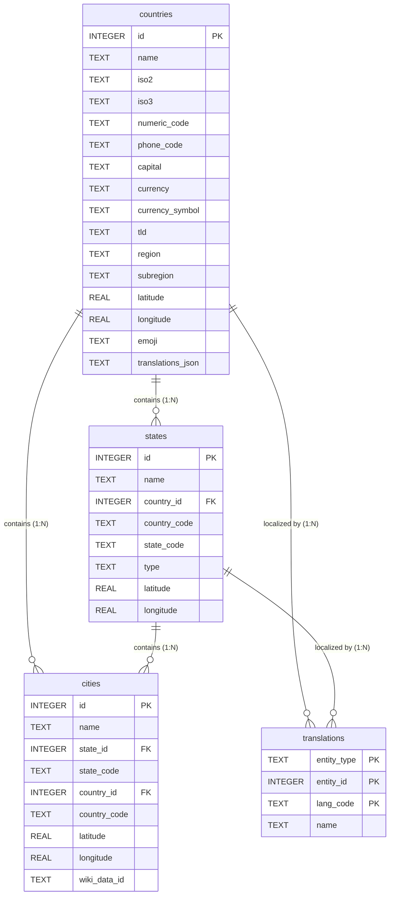

# Data Schema Overview

The embedded SQLite database (`moinogeo.db`) follows a normalized 3-tier relational hierarchy (`countries` → `states` → `cities`) with localized name translations and spatial coordinates.

---

## Entity-Relationship Diagram (ERD)



---

## Table Specifications

### `countries` Table
Contains top-level country metadata, international identifiers, currency data, and multi-language translations.

```sql
CREATE TABLE countries (
    id              INTEGER PRIMARY KEY AUTOINCREMENT,
    name            TEXT NOT NULL,
    iso2            TEXT NOT NULL UNIQUE, -- e.g. "US", "DE", "JP"
    iso3            TEXT NOT NULL,        -- e.g. "USA", "DEU", "JPN"
    numeric_code    TEXT,                 -- e.g. "840", "276", "392"
    phone_code      TEXT,                 -- e.g. "+1", "+49", "+81"
    capital         TEXT,
    currency        TEXT,                 -- e.g. "USD", "EUR", "JPY"
    currency_symbol TEXT,                 -- e.g. "$", "€", "¥"
    tld             TEXT,                 -- e.g. ".us", ".de", ".jp"
    region          TEXT,                 -- e.g. "Americas", "Europe", "Asia"
    subregion       TEXT,                 -- e.g. "Northern America", "Western Europe"
    latitude        REAL,
    longitude       REAL,
    emoji           TEXT,                 -- e.g. "🇺🇸", "🇩🇪", "🇯🇵"
    translations    TEXT                  -- JSON string backup: {"es": "Estados Unidos", "fr": "États-Unis", ...}
);

CREATE UNIQUE INDEX idx_countries_iso2 ON countries(iso2);
CREATE INDEX idx_countries_region ON countries(region);
```

### `states` Table
Contains primary administrative subdivisions (states, provinces, territories, regions, cantons).

```sql
CREATE TABLE states (
    id              INTEGER PRIMARY KEY AUTOINCREMENT,
    name            TEXT NOT NULL,
    country_id      INTEGER NOT NULL,
    country_code    TEXT NOT NULL,        -- ISO2 country code
    state_code      TEXT,                 -- e.g. "CA", "BY"
    type            TEXT,                 -- e.g. "state", "province", "prefecture"
    latitude        REAL,
    longitude       REAL,
    FOREIGN KEY(country_id) REFERENCES countries(id)
);

CREATE INDEX idx_states_country_id ON states(country_id);
CREATE INDEX idx_states_country_code ON states(country_code);
```

### `cities` Table
Contains over 150,000 cities, towns, and municipalities worldwide.

```sql
CREATE TABLE cities (
    id              INTEGER PRIMARY KEY AUTOINCREMENT,
    name            TEXT NOT NULL,
    state_id        INTEGER NOT NULL,
    state_code      TEXT NOT NULL,
    country_id      INTEGER NOT NULL,
    country_code    TEXT NOT NULL,
    latitude        REAL NOT NULL,
    longitude       REAL NOT NULL,
    wiki_data_id    TEXT,                 -- Wikidata identifier for external linking
    FOREIGN KEY(state_id) REFERENCES states(id),
    FOREIGN KEY(country_id) REFERENCES countries(id)
);

CREATE INDEX idx_cities_state_id ON cities(state_id);
CREATE INDEX idx_cities_country_id ON cities(country_id);
CREATE INDEX idx_cities_country_code ON cities(country_code);
CREATE INDEX idx_cities_name ON cities(name COLLATE NOCASE);
```

### `translations` Table
Contains normalized entity name translations across target languages (`en`, `fr`, `es`, `it`, `de`, `uk`, `ru`).

```sql
CREATE TABLE translations (
    entity_type     TEXT NOT NULL,        -- 'country', 'state', 'city', 'region'
    entity_id       INTEGER NOT NULL,     -- ID matching foreign table (e.g. countries.id)
    lang_code       TEXT NOT NULL,        -- ISO 639-1 language code e.g. 'fr', 'es', 'de'
    name            TEXT NOT NULL,        -- Localized entity name
    PRIMARY KEY (entity_type, entity_id, lang_code)
);

CREATE INDEX idx_translations_lookup ON translations(entity_type, entity_id, lang_code);
```
